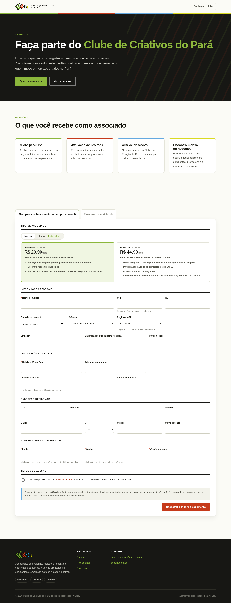
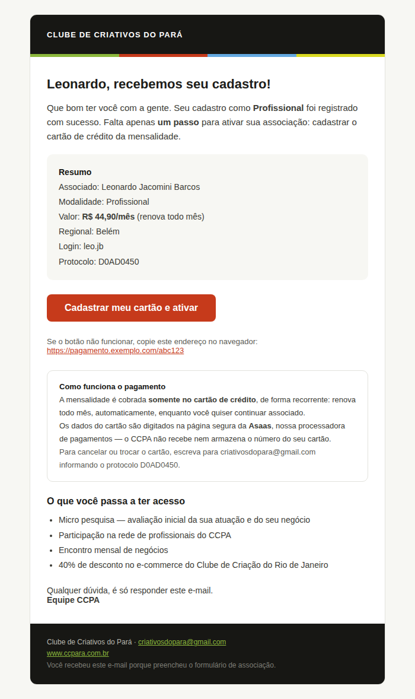

# CCPA Associados — projeto de portfólio

> [!IMPORTANT]
> **Este não é o site oficial do Clube de Criativos do Pará.** É um projeto de
> portfólio, *inspirado* no sistema de associados que desenvolvi para o CCPA e
> publicado com autorização da diretoria do clube. Não use este código para se
> associar nem para pagar nada. O site oficial do clube é
> **[ccpara.com.br](https://www.ccpara.com.br)**.
>
> *This is not the official Clube de Criativos do Pará website. It is a
> portfolio project inspired by the membership system I built for the club,
> published with the club's permission. The official site is
> [ccpara.com.br](https://www.ccpara.com.br).*

Membership signup, recurring billing and a management panel for a creative
association — modelled on **Clube de Criativos do Pará** (CCPA), a non-profit
association of creative professionals in the Brazilian state of Pará.

A visitor picks a tab (student, professional or company), a monthly or annual
plan, and fills the form. The member pays by credit card on Asaas's hosted
checkout (or, when enabled, by Pix), a webhook activates the membership, and
the team follows everyone up in a management panel with charts, CSV export,
WhatsApp reminders, reconciliation with the gateway and an LGPD audit trail.

**Stack:** Python 3.12 · FastAPI · Jinja2 · SQLAlchemy 2 · PostgreSQL (Neon) ·
Asaas (payments) · Resend (e-mail) · Vercel · pytest · ruff.

Out of the box it runs with a **simulated payment provider** (`PAYMENT_PROVIDER=mock`)
and SQLite: no gateway account, no real money, no e-mail sent.

> The code and comments are in English; the interface is in Brazilian
> Portuguese, because that is what the people filling in the form read.

<p align="center">
  
  
</p>

---

## The flow

1. A visitor picks a tab (individual or company), a plan, and fills the form.
2. The server validates everything, stores the member as `AWAITING_PAYMENT`
   and records the consent trail (timestamp and IP, for Brazil's LGPD).
3. The payment layer opens an Asaas customer and a `CREDIT_CARD` subscription
   on the chosen cycle, and gets back the hosted invoice URL.
4. Resend delivers the welcome e-mail with that link.
5. Asaas calls `POST /webhooks/pagamento` when the card is charged.
6. The member becomes `ACTIVE` and receives the confirmation e-mail.

### Routes

| Path | What it is |
|---|---|
| `/associe-se` | The signup page — both forms, plans and benefits |
| `/associe-se/pf`, `/associe-se/pj` | Form submission (individual, company) |
| `/associe-se/sucesso/{id}` | Confirmation, with the payment button |
| `/pagamento/simulado/{id}` | Fake checkout, only with `PAYMENT_PROVIDER=mock` |
| `/webhooks/pagamento` | Asaas callback |
| `/` | Redirects to `/associe-se` |

### Plans

Each tier is sold monthly or annually. The annual price is **eleven months for
twelve** — one month free.

| Tier | Audience | Monthly | Annual |
|---|---|---|---|
| Estudante | Individual | R$ 29,90 | R$ 328,90 |
| Profissional | Individual | R$ 44,90 | R$ 493,90 |
| Empresa | Company | R$ 69,90 | R$ 768,90 |

Only the monthly prices are written down, in cents, in `MONTHLY_PLANS`
(`app/plans.py`); the annual tiers are derived from them through
`ANNUAL_MONTHS`. Change 44,90 and the annual price follows, instead of the two
drifting apart.

Both cycles are rendered into the page and a toggle hides one, so the form
still works with JavaScript switched off — the hidden radios are `disabled`,
because a `required` radio inside a hidden container blocks submission with a
browser error the visitor never sees.

### Pix Automático

Alongside the card, a member can pay by **Pix Automático**: one QR code pays
the first period and, in the same step, asks the payer's bank to authorise the
recurring debit. Asaas then generates each charge itself
(`paymentCreationMode: SUBSCRIPTION`), and the authorization starts one period
ahead so the first period is not charged twice.

- Off until `PIX_AUTOMATIC_ENABLED=true` — Asaas has to enable it on the
  account first (company account, CNPJ active for six months). Off, the form
  shows the card only, exactly as before.
- There is no hosted checkout: the QR code and the copy-and-paste code are
  shown on our own success page, which is also the link in the e-mail, the
  WhatsApp message and the panel. An expired or refused code is replaced by
  the member from that same page.
- Pix charges come from a subscription Asaas creates by itself, so the webhook
  ties them to the member through the Asaas **customer id**, stored at signup.
  Authorization events (`PIX_AUTOMATIC_RECURRING_AUTHORIZATION_*`) update the
  mandate; a payer cancelling in their bank app cancels an active member.
  Re-run `scripts/setup_webhook.py` after enabling, so the webhook subscribes
  to them.
- The new `payments` columns are added by `ensure_schema()` — on boot and in
  `scripts/init_db.py` — so a deploy never reaches a database without them.

### Management panel — `/painel`

A signed-in area for the association to follow its members, built for two
kinds of account:

| Role | Can |
|---|---|
| **Administrador** | everything below, plus export the spreadsheet, create and deactivate users, read the access log |
| **Equipe** | overview, member list and detail, WhatsApp follow-up, reconciliation with Asaas |

- **Overview** — active, awaiting payment, overdue; monthly recurring revenue
  (annual plans ÷ 12); money received this month; signup-to-payment
  conversion; revenue and signups per month for the last twelve months; active
  members by plan and by chapter; who needs a follow-up.
- **Members** — search by name, e-mail, CPF/CNPJ (with or without
  punctuation), phone or login; filter by status, plan, cycle, type, chapter
  and signup date. The export downloads *that* filtered list, every form field,
  as a CSV Brazilian Excel opens correctly (`;` and a UTF-8 BOM), with
  formula-looking cells defused.
- **Member detail** — every form field, each invoice, the e-mails sent and,
  for administrators, who opened the record.
- **WhatsApp** — a button that opens a conversation with a ready message and
  the member's payment link. It replaces `scripts/pendentes.py` day to day.
- **Reconcile with Asaas** — pulls every subscription and invoice from Asaas
  and fixes whoever paid but was never activated because a webhook was lost.
  Asaas is where the money is, so Asaas wins. Running it twice changes nothing.

**Every renewal is counted.** `payments` holds one row per subscription;
`charges` holds each invoice, keyed by the Asaas id, written by the webhook on
every event. Without it, a member's second month would leave no trace and the
revenue figures would stop at the first payment.

**Security.** Signed `HttpOnly` session cookie carrying the account's session
version (a password change or a deactivation ends every open session), CSRF
token on every POST, five wrong passwords in fifteen minutes lock the e-mail
(counted in the database, so it holds across serverless instances), forced
password change after an administrator sets one, `no-store` and `noindex` on
every page. Each sign-in, record opened, export and change goes to
`audit_logs` — under the LGPD the association has to be able to say who saw a
member's data.

Getting started, against the production database:

```bash
python scripts/init_db.py      # creates the three new tables; touches nothing else
python scripts/criar_admin.py  # the first administrator
```

Set `SECRET_KEY` in the environment (at least 32 characters) before the
deploy; `check.py` refuses a production build without it. Everyone else is
created from inside the panel.

---

## Why it is built this way

- **The card never touches this application.** Asaas hosts the checkout page
  and we redirect to it. Tokenising the card in our own form would work, and
  would also drag the project into PCI-DSS scope for no gain.
- **Every input is validated before it reaches the database.** Pydantic schemas
  cover CPF and CNPJ check digits, postal code, phone, password strength and
  the terms checkbox — see `app/validators.py` and `app/schemas.py`.
- **The payment layer is an abstraction, not a gateway client.** The app asks a
  `PaymentProvider` for a checkout link; swapping gateways is one new class and
  one environment variable. See `app/services/payments.py`.
- **The webhook is idempotent.** Gateways retry, and a replayed event must not
  send the welcome e-mail twice.
- **A chargeback cancels the membership.** Card-specific and easy to forget:
  the money has already been taken back from the association.
- **The copy follows the cycle.** An annual member reads "anuidade" and "renova
  todo ano", on the page and in the e-mail, from one property on the plan
  rather than a hardcoded "mensalidade" in six templates.
- **A failing mail provider never rolls back a signup.** Every send is recorded
  in `email_logs` with the provider id or the error — that table is how you
  find out a member never got their payment link.
- **The app is honest about running without e-mail.** With no `RESEND_API_KEY`,
  the confirmation page stops claiming a message was sent and becomes the
  delivery instead: it shows the payment button and the address that returns to
  it. `scripts/pendentes.py` then lists whoever is stuck, to chase by hand.
- **Server-rendered HTML, no build step.** The JavaScript is vanilla and
  optional: input masks, tabs and postal-code lookup. The form works without it.

---

## Running locally

```bash
python3 -m venv .venv && source .venv/bin/activate
pip install -r requirements.txt
cp .env.example .env
uvicorn app.main:app --reload
```

On Windows (PowerShell), without activating the virtualenv:

```powershell
python -m venv .venv
.\.venv\Scripts\python.exe -m pip install -r requirements.txt
copy .env.example .env
.\.venv\Scripts\python.exe -m uvicorn app.main:app --reload
```

Open <http://localhost:8000>. It runs fully with `PAYMENT_PROVIDER=mock`, so
the whole signup-to-activation flow can be demonstrated with no Asaas account.

`requirements.txt` is the file Vercel installs, so everything the app needs at
runtime lives there. The Postgres driver carries a `sys_platform != "win32"`
marker: development on Windows runs on SQLite and does not need it, and a
version without a prebuilt wheel has broken this project's `pip install`
before. `requirements-prod.txt` adds gunicorn, for a server of your own.

---

## `check.py` — the missing build step

Python is not compiled, so nothing fails when the code is wrong: a bad import
or a `` in a template only surfaces when somebody opens the page.
`check.py` tries to break the application on purpose instead.

```bash
pip install -r requirements-dev.txt   # once
python check.py
```

Six stages, exit code 1 if any fails:

| # | Stage | What it catches |
|---|---|---|
| 1 | Dependencies | packages that conflict with each other (`pip check`) |
| 2 | Static analysis | undefined names, dead imports, unused variables, formatting (`ruff`) |
| 3 | Templates | Jinja syntax errors — every template compiled with the app's real environment |
| 4 | Configuration | a `Settings` field missing from `.env.example`; in production, `PAYMENT_PROVIDER=mock`, an empty Asaas key or webhook token, the sandbox URL, a non-HTTPS `BASE_URL` or a SQLite database. An empty Resend key only warns — running without e-mail is allowed, and the pages adapt |
| 5 | Tests | the pytest suite |
| 6 | Smoke | starts the real app and hits every route |

Autofix most of stage 2 with `ruff check --fix . && ruff format .`

**Running it automatically.** `python scripts/install_hook.py` installs a Git
pre-commit hook that aborts the commit on failure. GitHub Actions runs the same
script on Python 3.11, 3.12 and 3.13 for every push and pull request. On the
server, make it the last step before restarting: if it fails, the deploy stops
and the previous version stays up.

---

## Layout

```
app/
  main.py              FastAPI app, security headers, error handlers
  config.py            environment settings
  plans.py             >> PLAN CATALOGUE, PRICES AND CYCLES (edit here) <<
  brand.py             >> IDENTITY COPY (edit here) <<
  models.py            members, payments, e-mail log
  schemas.py           validation for both signup forms
  validators.py        CPF, CNPJ, postal code, phone
  security.py          Argon2id password hashing, client IP
  templating.py        Jinja environment
  routers/
    membership.py      signup forms, success page, mock checkout
    painel.py          management panel (/painel)
    webhooks.py        payment confirmation callback
  services/
    members.py         signup business rules
    email.py           Resend
    payments.py        payment provider abstraction (mock, Asaas)
    billing.py         per-invoice records and reconciliation with Asaas
    painel.py          the panel's figures, filters, export and audit trail
  templates/           Jinja2 (pages and e-mails)
  static/              CSS, JS, logo
tests/                 pytest
check.py               full pre-deploy verification
vercel.json            function timeout and bundle exclusions
scripts/
  init_db.py           create the tables (run once, per database)
  setup_webhook.py     register the Asaas webhook and mint its token
  criar_admin.py       first panel administrator, or rescue a lost one
  pendentes.py         who signed up and has not paid, with their payment link
  preview_emails.py    render the e-mails to HTML without sending
  install_hook.py      install the Git pre-commit hook
```

---

## Configuration

### Resend

1. Verify the domain and add the SPF, DKIM and DMARC records. Without them the
   mail is delivered to spam — and the payment link is inside that mail.
2. Put the API key in `RESEND_API_KEY` and set `MAIL_FROM` to an address on the
   verified domain.

### Asaas

1. Create the account and complete the association's KYC, so payouts settle
   into its own bank account.
2. Copy the API key from **Configurações → Integrações → Chave de API** into
   `ASAAS_API_KEY`, and set `PAYMENT_PROVIDER=asaas`.
3. Register the webhook. Doing it from the API beats ticking boxes in the
   dashboard, because the event list comes from the handler that consumes it:

   ```bash
   python scripts/setup_webhook.py https://YOUR_DOMAIN
   ```

   It prints a token; put that in `ASAAS_WEBHOOK_TOKEN`. Without it, anyone
   who finds the URL can mark a membership as paid, so `check.py` refuses to
   pass a production build that leaves it empty.
4. Test against the sandbox first — `https://api-sandbox.asaas.com/v3`. It is a
   **separate account** at sandbox.asaas.com with its own API key, approved
   automatically and free. `check.py` refuses to pass a production build still
   pointing at it.

| Provider | When to use |
|---|---|
| `mock` | Development. Internal fake checkout, end to end, no account needed. |
| `asaas` | Production. Recurring credit-card subscription. |

---

## Security and privacy

- The card is entered on Asaas's page; its number never reaches this
  application, its logs or its database.
- Passwords hashed with **Argon2id**, never logged, never e-mailed.
- The webhook token is compared in constant time.
- Rate limiting is per instance. On a serverless platform that means the
  effective limit rises with the number of live instances — it slows a crawler
  down, it is not a defence against a determined flood.
- CSP, `X-Frame-Options: DENY`, `nosniff`, HSTS in production.
- Rate limit of 120 requests/minute per IP.
- Consent stored with timestamp and IP.
- Secrets only in environment variables; `.env` is git-ignored.

Always run behind HTTPS — the forms carry passwords and national ID numbers.

---

## Deploying

### Vercel

Vercel detects FastAPI on its own: it loads `app` from `app/main.py`, which is
already where this project keeps it. There is no adapter file and no rewrite
table — `vercel.json` only sets the function timeout and keeps tests and docs
out of the bundle.

**The database cannot be SQLite.** A serverless filesystem is read-only and
thrown away between invocations, so a SQLite file would take the members with
it. Point `DATABASE_URL` at a hosted Postgres (Neon, Supabase, Vercel Postgres)
and use its **pooled** connection string where one is offered. A bare
`postgres://` URL is rewritten to `postgresql+psycopg://` at load time, so the
string can be pasted exactly as the provider hands it over.

Create the tables once, from your machine, against that database:

```bash
DATABASE_URL="postgresql://..." python scripts/init_db.py
```

Then set the environment variables in the Vercel project, including
`AUTO_CREATE_TABLES=false` — otherwise every cold start rebuilds the schema on
a database that already has it.

Two details worth knowing:

- The engine uses `NullPool` on Postgres. A pool held by an instance the
  platform is about to freeze still occupies a connection slot, and Postgres
  accounts have a hard limit; the provider's own pooler does the pooling.
- Static files stay inside the function rather than being promoted to the CDN,
  because the app has top-level middleware and Vercel keeps mounts in the
  function so that middleware still runs. To trade the security headers on
  static assets for CDN delivery, set `cdn = true` under
  `[tool.vercel.fastapi.static]` in `pyproject.toml`.

### A server of your own

```bash
pip install -r requirements.txt -r requirements-prod.txt
gunicorn app.main:app -k uvicorn.workers.UvicornWorker -w 4 -b 0.0.0.0:8000
```

Set `APP_ENV=production`, which disables the interactive API docs and enables
HSTS. A `Dockerfile` is included.

---

## License

The **code** is MIT — see [LICENSE](LICENSE).

The **Clube de Criativos do Pará name, logos and visual identity**, and the
membership terms in `app/static/termos-de-adesao.pdf`, belong to the club and
are **not** covered by the MIT license. They are here, with the club's
permission, only so the portfolio shows the project as it was built. If you
reuse this code, replace them with your own brand (`app/brand.py`,
`app/static/img/`).
